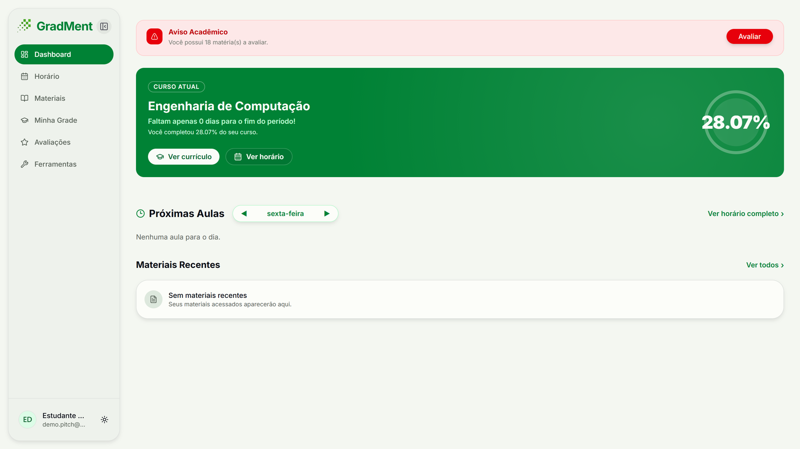
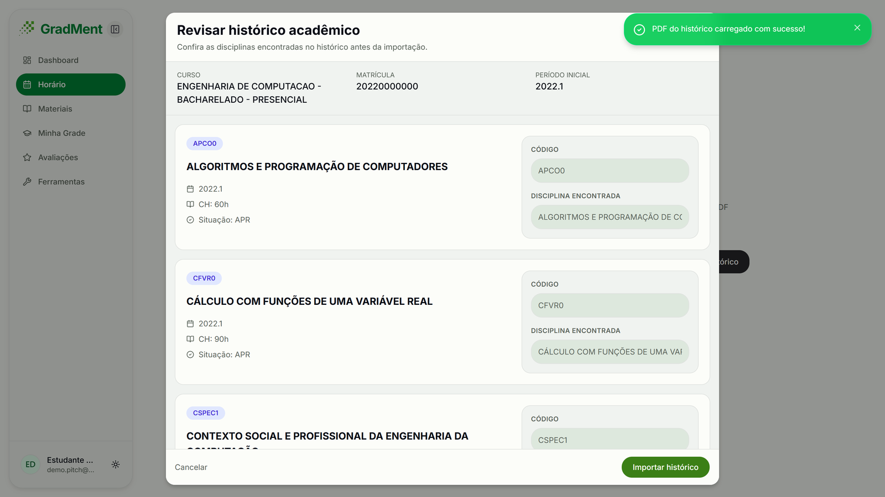
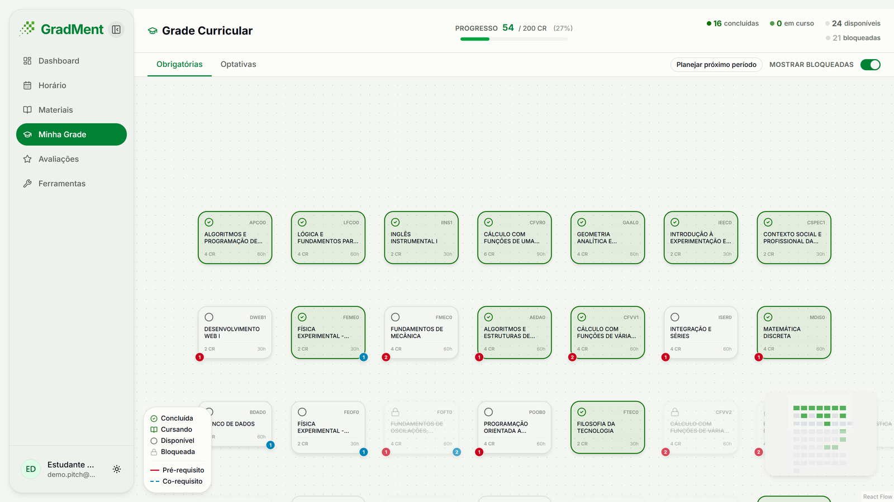
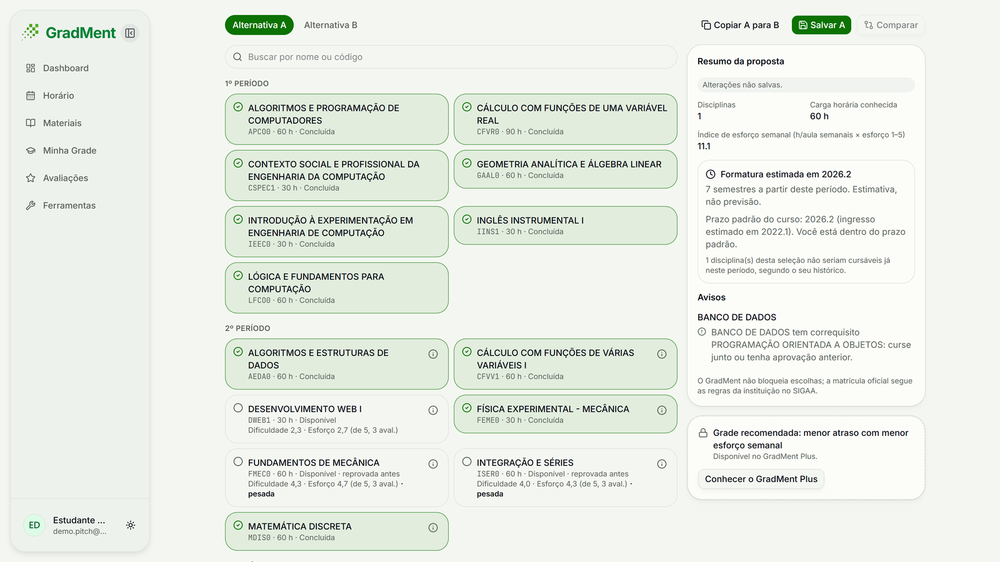
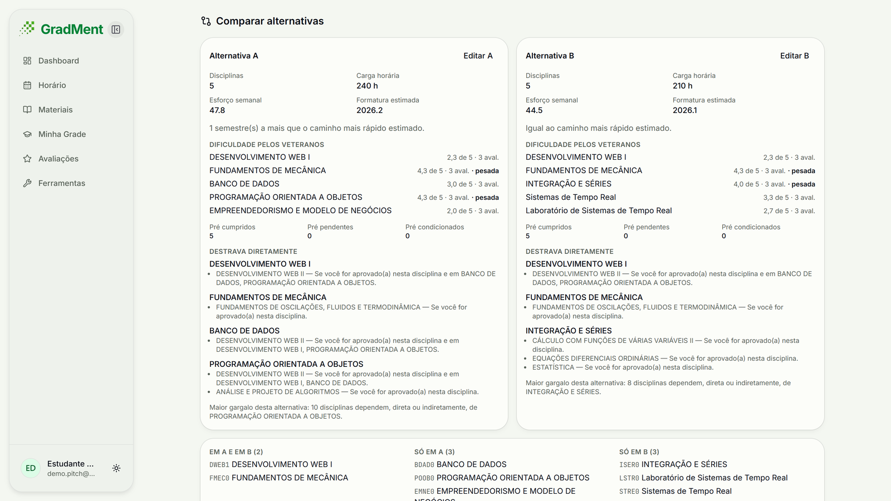
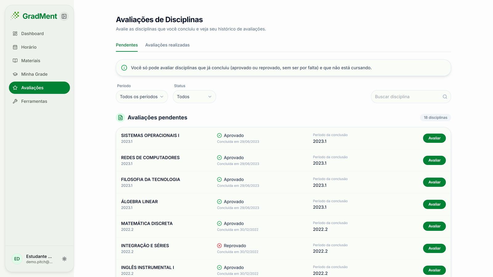

# GradMent

**Planejador de grade curricular que avisa o aluno quando uma reprovação vai atrasar a formatura.**

[gradment.com.br](https://gradment.com.br) · [Vídeo do pitch](https://youtu.be/dxQApeMtuUo) · [Vídeo de demonstração](https://www.youtube.com/watch?v=z5_0VSG5xW4)

> Este repositório não tem código nem dados de alunos. É só o caso do produto: o problema, para quem é, o que já funciona e o que decidi. O código é privado.

## O problema

Montar a grade do semestre é decidir no escuro: o aluno precisa lembrar de pré-requisitos, de como uma reprovação empurra as disciplinas seguintes e de quanto tempo isso adiciona à formatura.

## Para quem

Estudantes de graduação, começando pelos de Engenharia do CEFET-MG, e as coordenações de curso que acompanham a retenção.

## Como funciona

O aluno entra, importa o histórico do SIGAA em PDF e vê a grade curricular do curso: o que já concluiu, o que está disponível e o que está bloqueado por pré-requisito. Para planejar o próximo período, monta alternativas (A e B). Para cada uma, o GradMent mostra a formatura estimada, avisos de pré e correquisitos e a dificuldade e o esforço que os veteranos deram a cada disciplina, e depois compara as duas alternativas. Também há horário, materiais e avaliações de disciplinas. O GradMent não bloqueia escolhas: a matrícula oficial segue as regras da instituição no SIGAA.

Os cursos e as matrizes curriculares são cadastrados pela equipe; para levar o produto a outra universidade, converti o PPC em matriz com o pipeline do [`ppc-gradment-ia`](https://github.com/catarina051/ppc-gradment-ia).

Front-end em Next.js, React, TypeScript e Tailwind; back-end em CodeIgniter 4 com API REST.

## O produto

Capturas de uma conta de demonstração, feitas para o vídeo do pitch.

| | |
| --- | --- |
|  |  |
| **Dashboard:** progresso no curso e disciplinas a avaliar. | **Importação:** o aluno confere o histórico do SIGAA antes de importar. |
|  |  |
| **Grade curricular:** concluídas, disponíveis e bloqueadas por pré-requisito. | **Planejar o período:** formatura estimada, avisos de correquisito e dificuldade pelos veteranos. |
|  |  |
| **Comparar alternativas:** A e B lado a lado, com gargalos e carga semanal. | **Avaliações:** o aluno avalia disciplinas que concluiu. |

## Em números

Contagem agregada do banco de produção em 07/11/2026, só leitura:

| Item | Valor |
| --- | ---: |
| Alunos cadastrados | 72 |
| Alunos que enviaram o histórico | 40 |
| Linhas de histórico importadas | 1.739 |
| Avaliações de disciplinas | 121 |
| Cursos | 2 |
| Disciplinas no catálogo | 315 |

Nenhuma conta de teste entra nessa contagem. São números de um produto pequeno e novo, não de escala.

## Decisões difíceis

**Incubar só depois do primeiro cliente pagante.** Eu e o meu sócio, que é o desenvolvedor back-end desde o começo do projeto, conversamos sobre incubar e pesquisamos quanto custa abrir um CNPJ e se o GradMent tem, ou pode ter, clientes pagantes. Ainda estamos mudando o sistema para que o aluno realmente volte a usá-lo todo dia. Quando terminarmos essas mudanças e alguém clicar em "assinar", mesmo que a assinatura ainda não esteja funcionando, vamos incubar. Esse clique mostra que chegamos a um ponto em que o GradMent pode virar uma empresa, e não teremos tanto prejuízo, porque estaremos indo pelo caminho certo.

**Não rotular probabilidade de evasão.** Conversei com uma professora do CEFET que fez uma iniciação científica inteira sobre evasão. Ela me disse que não dá para entregar essa métrica: é um dado extremamente sensível e depende de muitos fatores, como questões pessoais. Se a coordenação procurar o aluno achando que ele vai evadir e estiver errada, ele pode não gostar. Por isso o GradMent mostra os dados e deixa que o próprio coordenador chegue às suas conclusões. Apliquei o mesmo princípio no [Termômetro do Semestre](https://github.com/catarina051/termometro-semestre), cujo aviso diz que o projeto não classifica alunos nem estima a chance de evasão de ninguém.

## O que aprendi

O GradMent foi um divisor de águas para mim. Aprendi a trabalhar em grupo, a gerir pessoas e processos, a pensar em produto e com a cabeça do usuário e a organizar um time. Fiz pesquisa de campo para entender os alunos e aprendi como se monta e se gere uma empresa, passo a passo. A pessoa que sou hoje, e o que decidi fazer com a minha vida, trabalhar com produto, vieram do GradMent.

## Contato

[LinkedIn](https://www.linkedin.com/in/catarina-rodrigues-gon%C3%A7alves-b42011297) · [Perfil no GitHub](https://github.com/catarina051)
